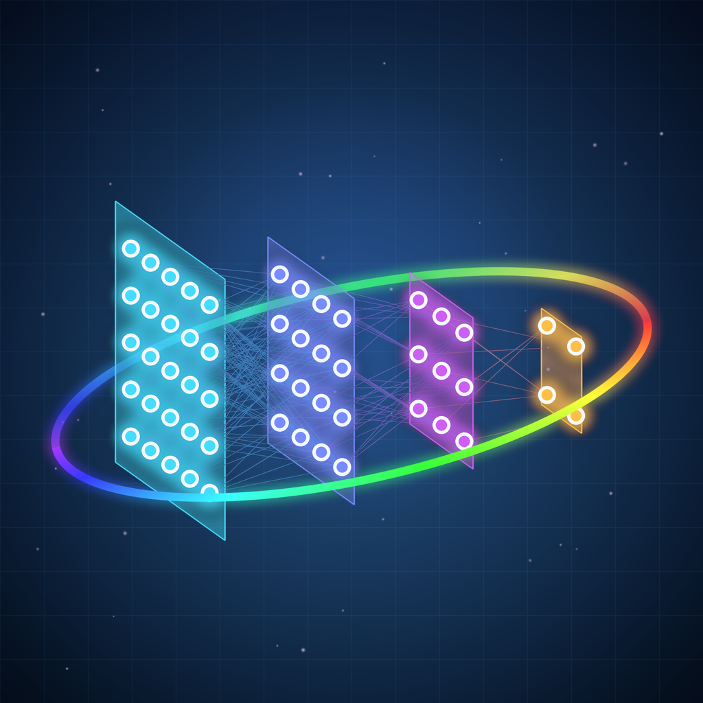
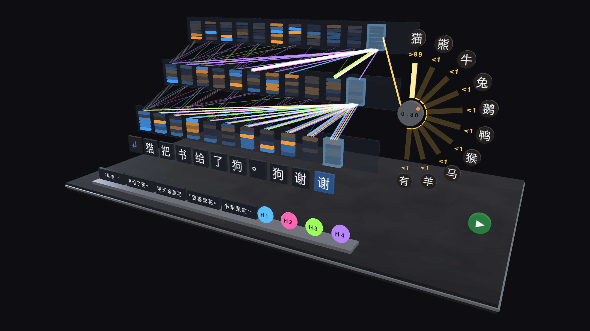
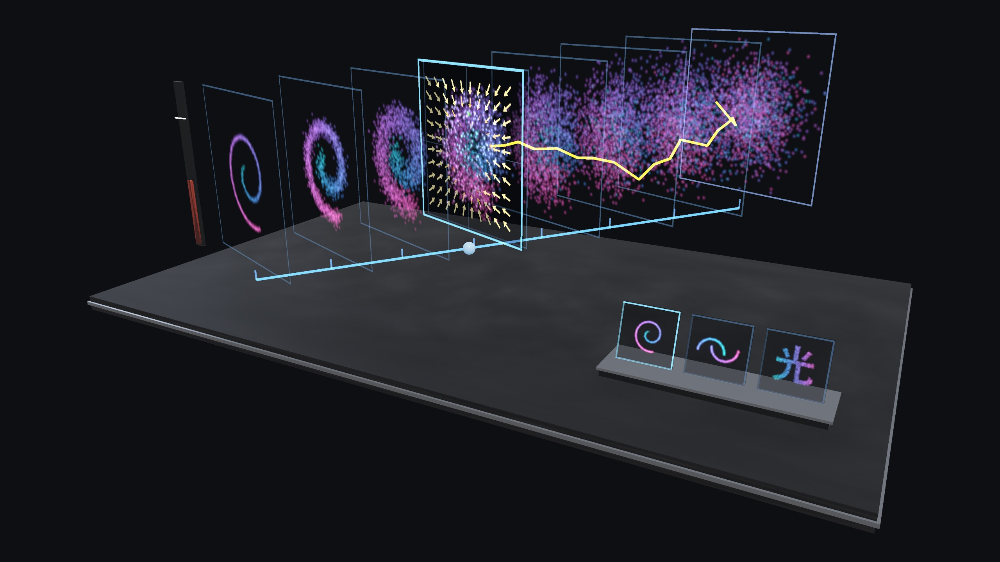
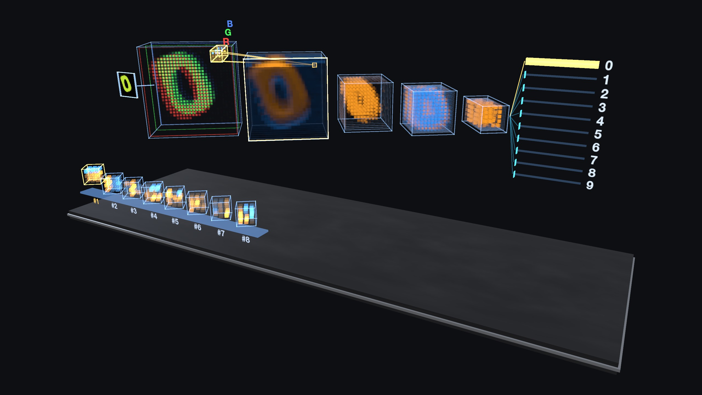
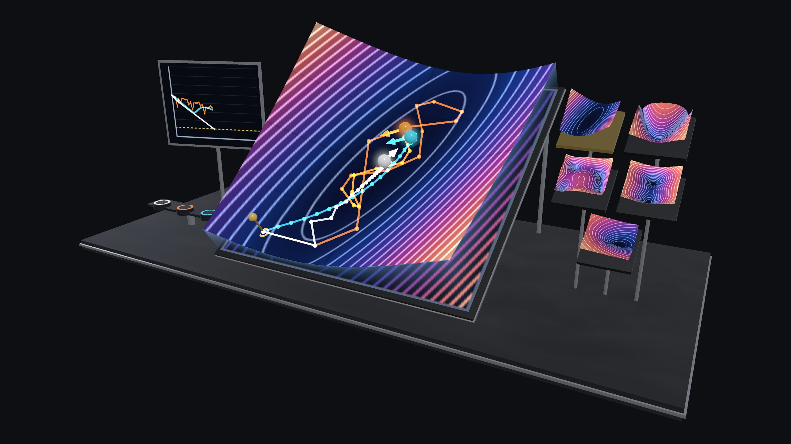
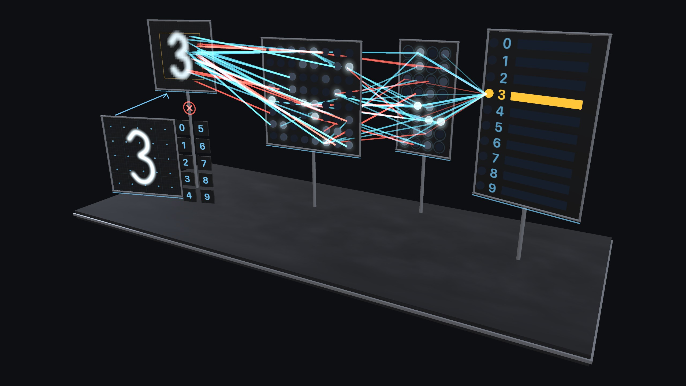
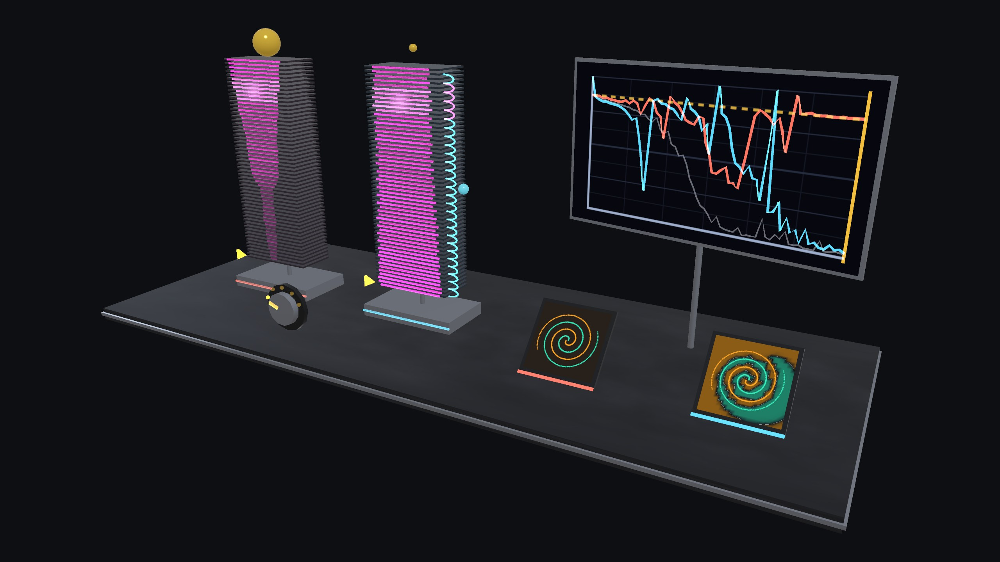
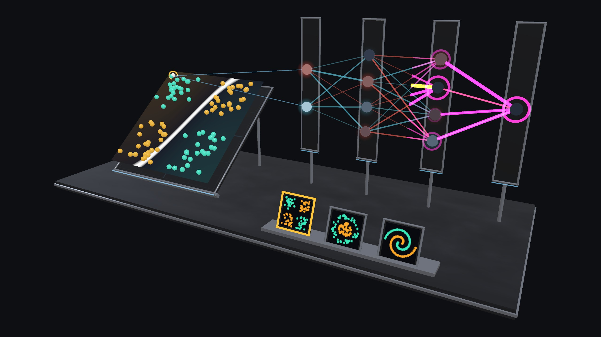
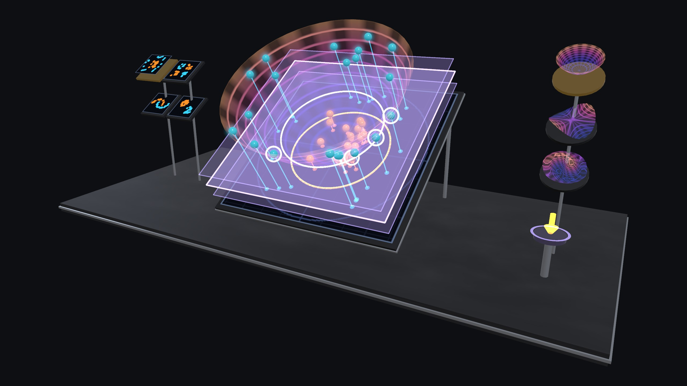
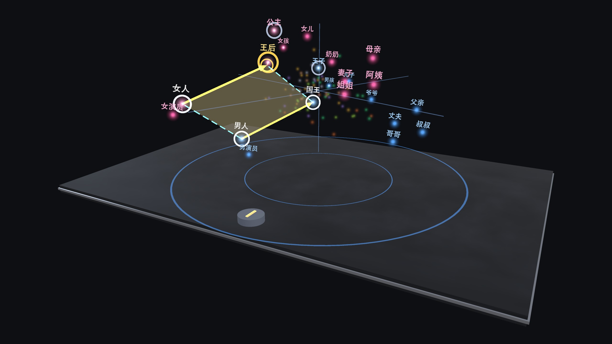

# AI 算法实验室 Spatial · AI Lab Spatial



9 个**真实运行**的小模型，做成可以走进去、拆开看的空间实验台，运行在 PICO 头显（Swan）的 Shared Space 中。
你可以看到：
- 神经网络一层层点亮；
- 梯度沿连线倒流；
- 注意力在字与字之间牵线；
- 噪声一步步被还原成图形。

灵感来自 3Blue1Brown 的神经网络系列。基于 PICO SpatialSDK（Kotlin + Compose）开发；中英双语界面。
姊妹作品：物理 / 化学 / 数学实验室 Spatial。

*9 small models that really run, as spatial lab benches you can walk around and take apart on PICO (Swan) Shared Space. Watch a network light up layer by layer, gradients flow backwards, attention thread characters together, and noise turn back into a shape. Inspired by 3Blue1Brown's neural-network series. Built with PICO SpatialSDK (Kotlin + Compose); Chinese / English UI.*

| | |
|---|---|
|  |  |
|  |  |
|  |  |
|  |  |
|  | |

*截图为 2560×1440 无头渲染（`ShowcaseRenderTest`），与头显内的场景同源。HD stills rendered headlessly from the same scene code that runs on the headset.*

## 实验 · Experiments

| 实验 | Experiment | 你可以做什么 · What you do |
|---|---|---|
| **基础 · Basics** | | |
| 神经网络 · 手写数字（Rumelhart 1986） | Neural Network · Digits | 捏合在空中写数字，看 784→64→32→10 一层层点亮 · Write a digit in the air and watch it light up layer by layer |
| 梯度下降 · 损失曲面（Cauchy 1847） | Gradient Descent | SGD / 动量 / Adam 在 5 种地形上赛跑，调学习率看发散 · Three optimisers race on five landscapes |
| 反向传播 · 链式法则（Rumelhart, Hinton & Williams 1986） | Backpropagation | 单步训练：前向脉冲、误差倒流、权重微调，决策曲面实时弯折 · One step at a time: forward, blame flows back, the surface bends |
| 核技巧 · 升维分类（Boser, Guyon & Vapnik 1992） | Kernel Trick | 把分不开的两圈点升到 3D，一个平面就分开了；只有支持向量起作用 · Lift the rings to 3-D and a plane separates them |
| **视觉 · Vision** | | |
| 卷积神经网络（LeCun 1989） | CNN | k×k×C 卷积核在 RGB / 多光谱张量上滑动；感受野一层层长大 · A kernel cube slides over a multispectral tensor |
| 残差网络 · 跳连（He et al. 2015） | ResNet | 回放真实训练记录：56 层普通网络梯度消失，跳连让它照样能训 · Replays real runs: gradients vanish in plain-56, skips fix it |
| **语言 · Language** | | |
| Transformer · GPT（Vaswani et al. 2017） | Transformer · GPT | 迷你 GPT 的注意力连线、因果遮罩、温度与下一个字的概率 · Attention threads, the causal mask, temperature |
| 词向量空间（Mikolov et al. 2013） | Word Embeddings | 国王 − 男人 + 女人 ≈ 王后：3D 平行四边形 · Analogy as a parallelogram you can walk around |
| **生成 · Generative** | | |
| 扩散模型（Ho, Jain & Abbeel 2020） | Diffusion Model | 时间作为第三维：数据融化成噪声，再沿分数场还原 · Time as depth: data melts into noise and flows back |

每个实验都带 **导学**：先预测、再动手、看结果、听解释，最后一个小挑战。
*Every experiment has a guided track — predict, do, observe, explain — and a challenge.*

## 模型是真的 · The models are real

- **训练与数据**：所有模型都用 PyTorch 在本机训练（`tools/train_*.py`，固定随机种子，可复现），数据全部是程序合成的：
  - 字体渲染的数字；
  - 合成的多光谱图块；
  - 2-D 点云；
  - 模板语法生成的句子。

  App 里的 Kotlin 推理与 PyTorch 逐层比对（误差 ≤ 1e-4），见 `app/src/test/.../core/`。
- **界面如实标注**：模型都很小（几千到十几万参数），界面会说明这一点，例如「迷你 GPT：2 层 · 4 头 · 约 11 万参数」。

*All models are trained locally with PyTorch on synthetic data (fixed seeds, reproducible). The in-app Kotlin inference is checked against PyTorch to ≤ 1e-4. The models are small and the UI says so.*

## 构建 · Build

要求 · Requirements：
- JDK 17
- Android SDK 35
- 联网拉取 PICO SpatialSDK 0.13.3（Volcengine Maven，见 `settings.gradle.kts`）· *network access for PICO SpatialSDK 0.13.3*

```bash
./gradlew :app:testDebugUnitTest     # ~100 JVM tests: model parity with PyTorch, scene contracts, lessons, UI review
./gradlew :app:assembleDebug         # app/build/outputs/apk/debug/app-debug.apk
adb install -r app/build/outputs/apk/debug/app-debug.apk
```

- `LabReviewTest` / `UiPreviewTest` / `ShowcaseRenderTest`（`-Dshowcase=true`）：无头渲染场景、面板与高清截图。*Headless scene, panel and HD renders.*
- `python3 tools/make_icons.py` / `tools/make_poster.py` / `tools/make_thumbs.py`：图标、海报、目录缩略图。*Icon, poster, catalogue thumbnails.*
